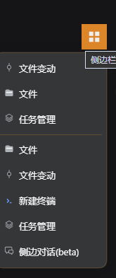
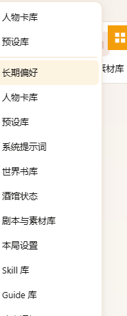

# dsh-sidebar-launcher

[English](./README.md) · **中文**

一个可拖动的 36×36 悬浮方块，挂在 DSH Web 外壳的右侧边栏上。它位于 frame 的浮层  
（overlay layer）里，鼠标悬停或点击时弹出右列的页签菜单，并把最近激活的三个页签固定  
在菜单离方块最近的那一端。右键方块会弹出第二个菜单，包含六项侧边栏操作。

它是一个**独立插件**：不声明对任何其他侧边栏插件的依赖，只读取宿主的公开 API，通过  
普通的 bundle-patch 通道挂载。

它能在**跨两代共四个宿主版本**上不经修改地运行——现代 grid 渲染器（DSH `0.1.7-rc.2`、  
`0.2.0-rc.2`、`0.2.1-alpha.2`）与旧式 flex 渲染器（`0.1.5-rc.2`，Tavern 桌面版所用）  
——方式是探测实际服务暴露了什么能力，而不是比较版本号。详见[跨宿主兼容](#跨宿主兼容)。

## 截图

现代宿主上的悬停菜单。最近三项排在卡片**离方块最近**的那一端，与全量列表之间由一条  
分隔线隔开：



同一菜单在旧式宿主（`0.1.5-rc.2`，Tavern）上的样子，每个标签都来自宿主自己的页签类型：



右键方块弹出的六行侧边栏操作卡片。图中"分栏"两项是置灰的，因为当前只开了一格停靠格：


### 演示

一段 18.7 秒的实拍，环境是 `0.2.0-rc.2` 宿主：悬停方块打开卡片、选择页签，再点一行
打开第二个页签并分出第二格。

<video src="./docs/launcher-demo.mp4" poster="./docs/launcher-demo-poster.png" controls muted loop width="462"></video>

如果你的 Markdown 渲染器不支持内联视频，文件本身在
[docs/launcher-demo.mp4](./docs/launcher-demo.mp4)，静帧在
[docs/launcher-demo-poster.png](./docs/launcher-demo-poster.png)。

## 它做什么

- **悬浮方块。** 36×36，直角（非圆角），首次运行时贴在右列自己的开关按钮下方；边栏  
  尚未渲染时落在视口右下角。
- **可拖动。** 仅主键。位移小于 4px 视为点击，4px 及以上视为拖动。位置跨刷新记忆，  
  并始终钳制在视口内，保证整个方块可见。
- **悬停 / 点击菜单。** 一个下拉卡片，列出宿主自己的页签指南里的全部条目——与右列  
  `+` 菜单相同的条目、相同的顺序。最近激活的三个页签固定排在离悬浮球最近的那一端：  
  卡片向**下**开（球在上半屏）时排在卡片**顶部**，卡片向**上**开（球在下半屏）时排在  
  卡片**底部**，与全量列表之间隔一条分隔线。
- **左键点某一行**在**左格**打开该页签。**右键点某一行**在**右格**打开；还没有右格且宿主  
  允许分栏时，先拆出一个右格，再把页签开进去。没有空间分栏时，宿主会静默落在当前格，与  
  它自己的分栏按钮行为一致。右列整体收起时，左右键都会先把侧边栏打开（单栏）。这里的  
  「左/右」是宿主自己的列，不是文档顺序——详见[如何读取侧边栏的形状](#如何读取侧边栏的形状)。
- **点击行不关闭菜单。** 只有指针离开「球 + 卡片」区域才关闭；卡片开着期间行序冻结，  
  连续点击两行不会跳行。
- **跟随主题与语言。** 颜色只取自 `--dsw-alias-*` 令牌，每个标签都经 locale 服务与  
  页签类型自己的可翻译标题读取。

## 侧边栏操作菜单

右键方块会弹出第二张卡片，与悬停菜单相互独立。两者不会同时出现：打开一个会关闭另一个。

| 菜单项              | 行为                           |
| ---------------- | ---------------------------- |
| **清空标签页（保留浮动）**  | 关闭全部**停靠**页签，随后收起侧边栏。浮动面板不动。 |
| **清空全部标签页（含浮动）** | 关闭全部页签（停靠 + 浮动），随后收起侧边栏。     |
| **清空左分栏**        | 关闭最左那个停靠格里的页签。只有一格时置灰。       |
| **清空右分栏**        | 关闭最右那个停靠格里的页签。只有一格时置灰。       |
| **清除所有浮动面板**     | 关闭全部浮动面板，停靠格不受影响。没有浮动时置灰。    |
| **重置悬浮球位置**      | 把方块送回测量出的锚点，并清除已保存的位置。       |

分隔线把六项分成三组：前两项"清空并收起"、中间三项分栏/浮动、最后一项方块自身的重置。

### 几条需要知道的行为

- **唯一的停靠指南页永远不会被关闭。** 当 `guide` 是唯一的停靠页签时，宿主会拒绝  
  关闭它（`canCloseTab` 要求 `!soleDockedTab`），所以"清空标签页"总会剩下这一页。  
  插件自己复刻了同一条规则，而不是依赖宿主的守卫。**浮动面板里的指南页不受保护**——  
  宿主的规则限定 `host === "dock"`——它会像其他浮动页签一样被关闭。
- **清空一格并不总会拆掉分栏。** dockkit 的 settle 过程会合并空 pane，但明确跳过  
  root pane，所以清空分栏结构中的 root 一格时，它会被清空而分栏结构保留。
- **关掉浮动面板的唯一页签，面板就消失了。** 同一个操作会把该 float pane 从布局里摘除，  
  因此不需要任何"关闭面板"的 API。
- **置灰状态在开菜单时从实时 DOM 与 API 计算**，不缓存：停靠格少于两格时分栏两项置灰，  
  没有浮动时浮动项置灰。

## 前置条件

- DSH Web，以下之一：`0.1.5-rc.2`、`0.1.7-rc.2`、`0.2.0-rc.2`、`0.2.1-alpha.2`。
- 右侧边栏（`@deepseek-ai/dsh-client-ui-sidebar-right`），`dsh-web-app` 默认会挂载它。  
  没有它插件保持不激活，方块直接不出现——`sidebarRight`/`sidebarRightTabs` 是等待  
  就绪的，从不假设它们存在。

## 安装

```sh
dsh plugin --profile web add ./dsh-sidebar-launcher
```

```sh
dsh plugin --profile web add <文件地址>
```

## 目录结构

```
package.json            dsh.bundle.patch + dsh.client {platform:"web", inject:[...]}
cordis.patch.yml        一条 insert：宿主行（空半边，存在是为了让 client 扫描发现它）
tsdown.config.ts        host ESM + 浏览器 module-loader 产物
tsconfig.json           strict、no-emit 类型检查（也覆盖构建配置）
tsconfig.build.json     只产出声明文件到 lib/types
tsconfig.evidence.json  把 src/client 编译成普通 JS，供验证脚本使用
src/index.ts            宿主半边：刻意留空
src/client/
  index.tsx             apply()：注册语言、等待服务、注册槽位、
                        两个菜单的持有者与分发
  launcher-ball.tsx     方块本身、它的拖动，以及悬停/点击/右键状态机
  launcher-menu.tsx     页签下拉卡片，基于宿主的 Menu/MenuItemButton 原语
  sidebar-action-menu.tsx  六行操作卡片及其纯函数行构造器
  sidebar-actions.ts    当前开着什么、怎么关：停靠/浮动划分、左右格排序、指南页守卫、收起
  menu-card.ts          两个菜单共用的卡片管线（定位 portal 卡片、避让方块）
  placement.ts          一行的左/右手势如何抵达各代宿主的分格
  entries.ts            guide() -> 菜单的两个分区
  recent.ts             持久化的最近列表与页签条追踪器
  anchor.ts             首次摆放与视口钳制
  capabilities.ts       决定各宿主分支的能力探测
  host-access.ts        读取两代宿主服务形状的唯一位置
  context-types.ts      所消费宿主服务的结构化镜像
  locales.ts            中/英文界面文案
  launcher.css          只用令牌的样式，插件前缀的字面类名
docs/                   本 README 使用的截图与演示录像
.evidence/              下文描述的验证脚本
```

## 跨宿主兼容

插件同时运行在四个宿主版本上，它们的客户端 API 形状不同。其中三个——`0.1.7-rc.2`、  
`0.2.0-rc.2`、`0.2.1-alpha.2`——是现代形状（grid 渲染器、`tabsIn`、observable `mounted`、  
导出 `MenuItemButton`）；`0.1.5-rc.2`（Tavern 桌面版）是旧式 flex 渲染器。每一个分支  
都是通过对活对象问一个 `typeof` 问题来选择的——浏览器 bundle 里读不到版本字符串，而且  
拿版本号当判据本身就是问错了问题。这些探测集中在 `capabilities.ts`：

| 探测                       | 现代（0.1.7 / 0.2.0 / 0.2.1） | 旧式（0.1.5）                      |
| ------------------------ | ------------------------- | ------------------------------ |
| 导出 `MenuItemButton`      | 有 → 组件行                   | 无 → `items` 数据行                |
| 存在 `sidebarRight.tabsIn` | 有                         | 无 → 读 `mounted()?.layout.tabs` |
| `mounted` 是 observable   | 是                         | 否 → 它是普通方法                     |
| 存在 `sidebarRight.split`  | 有                         | 有 → 两代走同一套摆放                   |
| 写出 `data-dockkit-column` | 有 → 左右由它给出                | 无 → 退回几何测量兜底                   |

代价最大的几处：

- **`mounted` 的差别在种类，不只是有无。** 在 0.1.5 上它是会解构 `this` 的类方法；  
  把引用摘下来裸调会抛异常。所有调用都显式带上接收者。
- **两代的 `split()` 都会给新格播种**宿主的默认页，所以只调 `split() + openTab()`  
  会在用户要的页签旁边留一个多余页签。插件会认出「这次分栏新增的那个页地址页签」并通过  
  `replaceTab` 替换掉。
- **摆放不再按代分支。** 上一轮在 0.1.7 用 `preferNewPane`、在 0.1.5 用 `split()`。  
  宿主 `openContent` 归约器对「目标格里已经开着的页面类内容」会把新格请求短路成普通的聚焦，  
  所以这个选项在最需要它的那一行（右键已开项）上根本分不了栏。现在两代统一走  
  `split()` + `openTab({ paneId })`；这也顺带退役了 `preferNewPane` 那个探测——  
  它是兼容层唯一的已知假设，没法用 `typeof` 探测、只能别名到 `tabsIn`，写在  
  `capabilities.ts` 里。

## 最近列表的来源

首选来源是宿主自己的页签条。dockkit 的 chip 带 `role="tab"` 与 `aria-selected`，并通过  
`data-dockkit-tab` 标识自己，位于 `[data-dockkit-strip-tabs]` 容器内，所以监听  
`aria-selected` 的 `MutationObserver` 就是宿主在报告用户刚激活了哪个页签。三个细节都  
很关键：

- 观察器只在变化时触发，所以挂载路径会先扫一次页签条；
- 切换会话时 seat 会被替换，所以 `sidebarRight.mounted` 变化会重新扫描并重绑（在 0.1.5  
  上没有这个信号，改用监听 seat 替换的 body 观察器覆盖同一过渡）；
- `tabId` 通过 `active()` 解析成 `kind`，另一个格里的页签则回退到当前会话的完整记录列表。

如果在会话已挂载的情况下**从未**见过页签条，列表会降级为"从本启动器打开过的页签"，并且  
菜单会**明确显示一条提示**说明降级。它绝不会仅因为右列恰好收起就降级，也绝不会隐藏降级。

只持久化 `kind` 字符串（`dsh-sidebar-launcher:recent`）。图标是组件、标题是 thunk，两者  
都在渲染时重新查表——这正是最近几行能跟随语言切换、以及跟随某个页签类型在插件之间迁移的  
原因。

方块自身的位置单独持久化（`dsh-sidebar-launcher:position`），"重置"除了移动方块**也会  
清掉这个键**——否则刷新会把保存的位置原样放回来。

## 如何读取侧边栏的形状

在这方面 `sidebarRight` 只提供 `close(tabId)`，别的都没有：没有 `closeAll`、没有  
`closePane`、也没有布局树。`tabsIn(sessionId)` 返回**不带 pane 归属**的扁平记录，所以  
"左边那一格"根本无法从 API 读到。由此有两条规则：

- **浮动页签是集合差，绝不扫 DOM。** 浮动面板的头部带 `data-dockkit-float-grip` /  
  `-title` / `-dock` / `-close`，但**没有** `data-dockkit-tab`，所以浮动页签的 id  
  无法从它自己的标记里恢复。它按 `API 全集 − 停靠集` 计算，这也正是诚实的定义：一个页签  
  是浮动的，当且仅当它开在停靠格之外的地方。
- **停靠格的分组是唯一的 DOM 依赖。** 它来自 `[data-dockkit-pane]`，按宿主自己写的  
  `data-dockkit-column` 从左到右排序（该属性缺失时退回 `getBoundingClientRect().left`）。  
  按**文档顺序**排会是错的：现代 grid 渲染器按**页签 id 字典序**  
  （`Object.values(tabs).sort((a, b) => a.id.localeCompare(b.id))`）输出格子，之后才用  
  `gridColumn: column * 2 + 1` 摆位，所以 DOM 顺序等于各格激活页签 id 的字典序，与左右  
  毫无关系。旧式 flex 渲染器完全不写列号、本身已是视觉顺序，所以这条兜底是活路径，  
  不是死代码。只有"清空某一分栏"这两项与左右键手势依赖它，其余不依赖。

容器属性也分代：现代宿主标记为 `[data-sidebar-right-session]`，而 0.1.5 没有这个属性，  
面板是 `[data-sidebar-right-panel]`。两者都被接受。

## 样式

颜色只用宿主令牌。方块是唯一的实心琥珀表面（`--dsw-alias-state-warn-primary`，悬停与  
拖动用 `--dsw-alias-state-warn-label`）；卡片取 `--dsw-alias-bg-layer-3`；悬停填充是  
12% 的 `color-mix` 叠色，卡片描边是 20% 的细线。文字与图形取自 `--dsw-alias-label-*`。

两个菜单都刻意穿着**同一套中性数值**，取值落在两代宿主自身菜单度量之间而不是照抄任何  
一方——否则同一个插件在两个宿主上会长得明显不同。卡片宽度按最长一行自适应  
（`width: max-content`，范围 160–320px；较高的操作卡片用 196–264px），**纯 CSS 实现**，  
超长标签由宿主自己的 `text-overflow: ellipsis` 收尾。

两个后果如实说明：本插件的菜单不再与任一宿主上**其他**原生菜单完全一致；并且 0.1.7 的  
毛玻璃卡片材质被换成了不透明填充，换取在**没有背景模糊**的宿主上仍可读。

在 0.1.7 上，卡片的背景是由内层 `MenuSurface` 图层绘制的，而不是卡片本身；那一层被  
显式中和掉了，否则不透明填充会被合成在半透明模糊之下。

## 定位

卡片优先开在方块所在半边之外：球在中线以下就向上开，以上就向下开。这在通常情况下消除了  
重叠，但**并不能保证**不重叠——一张很高的卡片被宿主自己的视口边距钳制时，会被推回到方块  
上方。所以卡片打开期间有一个逐帧检查把它推开，写的是 `transform` 而**绝不是**  
`left`/`top`，因为 0.1.7 的宿主每帧重算位置，会覆盖写进这两个属性的任何值。因此菜单  
开着时拖动方块，卡片会实时避让。

## 验证

`pnpm build` 产出 `lib/index.js` 与 `lib/client.js`。client 产物是一个  
`window.__ModuleLoader__.load({ id, factory })` 闭包，带 `apply`/`inject`——与宿主  
自己的 client bundle 形状相同——它唯一的运行时 import 是模块表条目 `react`、  
`react/jsx-runtime` 和 `@deepseek-ai/dsh-client-ui-primitives`。

`.evidence/` 目录放着开发期间用的验证。`cross-host.mjs` 是核心那个：它把同一份启动器  
模块分别对着**两代各自真实安装的** primitives bundle 加载，断言能力探测、菜单组装、  
左/右键分发、右键索引拒绝，以及非活动页签的 kind 能解析而不抛异常。它是钉住"一份代码、  
两代宿主"的回归。左右格排序另有两份证据：`sidebar-actions-check.mjs` 直接覆盖排序与兜底；  
`next-round-column-order.mjs` 把真实的 `0.2.0` 界面驱动到「文档顺序与列号顺序相反」的状态，  
断言左键落在视觉左格、右键落在视觉右格，并打印旧文档顺序代码会选中哪一格。

```sh
node .evidence/run-cross-host.mjs          # 两代宿主（现代 + 旧式）
node .evidence/ball-interaction.mjs        # 方块的手势状态机
node .evidence/sidebar-actions-check.mjs   # 操作分区、指南页守卫、收起
node .evidence/menu-interaction.mjs        # 页签下拉的接线
node .evidence/avoid-residue.mjs           # 避让确实触发，且不留残留
```

三个必须说清的限制。菜单类脚本用了一个忠实于契约的替身替代宿主 primitives，所以它们证明的是  
**本插件自己**的行与分发接线，而不是 primitives 的内部；primitives 自身的行为另有一套针对  
已安装包的验证。读 DOM 的检查是通过插件自己也在用的同一套属性契约去读宿主标记，所以它们确认  
的是"插件与它所依据的标记一致"，而不是"宿主会一直保留这套标记"。而且这些脚本都不能替代  
**看真实页面**：外观、真实指针手感与主题渲染都是在运行中的界面里确认的。

## 三处设计决定的说明

每一处都与原始需求的字面读法不同，理由都能在已安装的宿主代码里找到：

- **下拉卡片走 portal。** app frame 是 `overflow: hidden`，就地渲染的列表会被列的边缘裁掉。  
  portal 出去的卡片 `z-index`（1100）高于浮层的（20）。
- **悬停宽限在这里自己实现，而不是用 `closeOnPointerLeave`。** 那个原语只把宽限接到它的  
  触发包裹器上；列表一旦 portal 出去就没有东西取消它，指针一移到卡片上菜单就会关。持有的  
  组件自己跑一个等效的 200ms 宽限，覆盖方块与卡片两者。
- **两个菜单用不同的卡片类名。** 有几处效果只按类名找卡片——悬停宽限、避让的残留清理、  
  legacy 卡片打标——而且各自取第一个匹配。一张卡片一个类名会让它们全都猜错找到的是哪张。

## 许可

MIT
